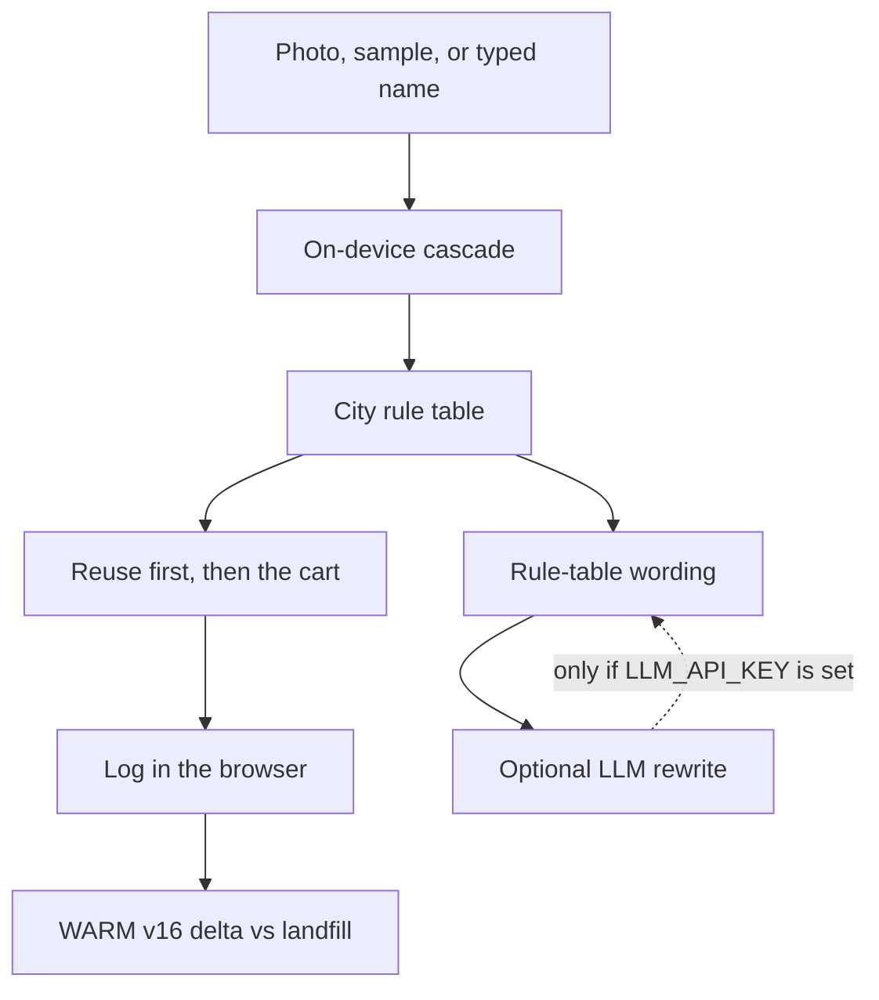

# Looktwice

Looktwice is a solo-student project for Arbiter Hacks V1 on the **Rethinking Waste** track. You name an object, or give it a photo, and the app asks whether it should stay in use before it names a bin. The bin follows a November 2026 snapshot of rules for San Francisco, Seattle, New York City, Austin, or a conservative US baseline. The choice goes into a log on your device: kilograms diverted, and CO2e only where EPA WARM v16 publishes a factor.

It runs with no API key. An optional language model can rewrite the wording. It cannot change the bin.

## Problem

Most of what a household throws away was still a decision. Food that could have been eaten, a jar that could have stored leftovers, a shirt a donation dock would take, and a battery that can start a fire in a truck all get treated as trash because the rule is local, easy to get wrong, and invisible at the moment of the toss. Scanner apps answer with a bin. That skips the waste hierarchy, and it ignores that these four cities do not agree about pizza boxes, yogurt cups, coffee cups, plastic film, or alkaline batteries. Looktwice is a small decision desk for that moment. It asks whether the thing should stay in use, applies one city’s published rules, and writes the choice into a log whose climate math comes from EPA WARM v16, including the cells WARM leaves blank.

## How impact is measured

Looktwice measures impact as mass diverted from the landfill and as greenhouse-gas emissions relative to landfilling, using the US Environmental Protection Agency Waste Reduction Model, version 16 (December 2023). For a logged decision, the app takes the WARM net emission factor for the path actually chosen — source reduction at the current mix of inputs when reuse avoids a new purchase, recycling, or composting — subtracts that material’s WARM landfilling factor, and converts the difference from metric tons of CO2e per short ton into kilograms of CO2e with the factor 1 short ton = 907.18474 kg. A negative result is reported as emissions avoided. Kilograms still count as diverted when you reuse, recycle, compost, or use a real drop-off even if WARM has no factor: plastic film, composted cardboard, clothing, ceramics, and household batteries are in that group on purpose, so the climate total cannot be inflated with a borrowed number. Food is entered on a wet-weight basis, which is how WARM states it, and the default grams are editable reference weights rather than measurements. The mile comparison divides avoided kilograms by 0.393 kg CO2e per mile, the EPA equivalency for a gasoline passenger vehicle in the November 2024 calculator update. The arithmetic is there to keep the order of operations honest: eating edible food or keeping a phone in use moves the WARM numbers more than parking the same object in the right cart, and composting mixed yard trimmings does not even win on greenhouse gases against landfilling. Diversion and climate are both shown because they are not the same claim.

The same paragraph is on the Method page, next to the factor table and four worked examples. Sources:

- [WARM v16 management-practice factors (PDF)](https://www.epa.gov/system/files/documents/2024-01/warm_management_practices_v16_dec.pdf)
- [EPA WARM versions](https://www.epa.gov/waste-reduction-model/versions-waste-reduction-model)
- [EPA GHG Equivalencies Calculator, calculations and references](https://www.epa.gov/energy/greenhouse-gas-equivalencies-calculator-calculations-and-references)

City pages are linked from each result and from the Rules page. This is decision support, not a hauler and not legal advice. When the cart and the app disagree, believe the cart.

## Architecture



The cascade, in order:

1. Sample tray or an explicit pick. No model.
2. File name, if it contains a catalog alias such as `pizza-box`.
3. Optional MobileNet, loaded in the browser from a CDN, mapped through a fixed ImageNet table. Off by default.
4. A color guess from pixels downsampled on the device. It always asks you to confirm.
5. Otherwise it refuses to invent a bin.

Photos are not uploaded. The log lives in `localStorage`. The optional `POST /api/enhance` route calls an OpenAI-compatible chat endpoint and is told not to assign a different stream. If the key is missing or the call fails, the rule-table paragraph stays.

## Setup

Node.js 22 or newer.

```bash
npm install
cp .env.example .env.local   # optional
npm run dev
```

Open the URL Next prints. The dev server in this project is often started on port 4179:

```bash
npm run dev -- --port 4179
```

Scripts:

| Script | What it does |
| --- | --- |
| `npm run dev` | Next.js dev server |
| `npm test` | Vitest. Rules, WARM math, classifier, log, guidance. |
| `npm run lint` | ESLint |
| `npm run build` | Production Node build (includes optional `/api/enhance`) |
| `npm run build:static` | Static export for GitHub Pages (`out/`, basePath `/looktwice`) |
| `npm start` | Serve the production Node build |

### Optional language model

Leave the key empty and nothing is called.

```bash
LLM_API_KEY=sk-...
LLM_BASE_URL=https://api.openai.com/v1
LLM_MODEL=gpt-4o-mini
```

`LLM_BASE_URL` is any OpenAI-compatible `/chat/completions` host. The bin is still chosen in `lib/items.ts`.

### Optional on-device vision

On the Decide page, turn on “On-device vision.” The first photo downloads TensorFlow.js and MobileNet (about 16 MB) from jsDelivr, then classifies in the browser. If that download fails, the file name and the color guess still run.

## Deploy

**Live static demo (GitHub Pages):** https://wangli-hackathon.github.io/looktwice/

That build is produced with `npm run build:static`. It ships the sorter, city rules, on-device log, and WARM math. The optional `POST /api/enhance` LLM rewrite is not available there; the UI keeps the rule-table wording and notes that enhance needs a server deploy.

For a full Node deploy (including optional enhance), use Vercel or any host that can run `npm run build` then `npm start`. Set the three `LLM_*` variables only if you want the rewrite. The demo does not need them.

Cloudflare Pages is not a one-click target for this Next.js version when you want the enhance route and Cache Components. Use the static export above for a no-server demo, or a Node host for the full app.

## Catalog

Twenty-three household objects. The interesting disagreements:

| Object | San Francisco | Seattle | New York | Austin | Baseline |
| --- | --- | --- | --- | --- | --- |
| Greasy pizza box | Compost | Compost | Compost | Compost | Landfill |
| Single-serve yogurt cup | Recycle | Landfill, under 3 inches | Recycle | Recycle | Recycle |
| Paper coffee cup | Recycle | Landfill | Landfill | Recycle | Landfill |
| Plastic bag | Store drop-off | Garbage | Trash | Store or drop-off | Landfill |
| Alkaline battery | Drop-off | Banned from garbage | Trash is allowed | Drop-off | Drop-off |
| Lithium battery | Drop-off | Drop-off | Drop-off, illegal in trash | Drop-off | Drop-off |

## What is left before the December 21, 2026 deadline

- Public repo and static demo URL are up (see Deploy above). Put both on the Devpost submission.
- Record the 2–3 minute video from `DEMO_SCRIPT.md`.
- Re-read the four city pages before you submit. Haulers change lists.
- Optional: a Node deploy with a real key for the wording rewrite, and more cities.
